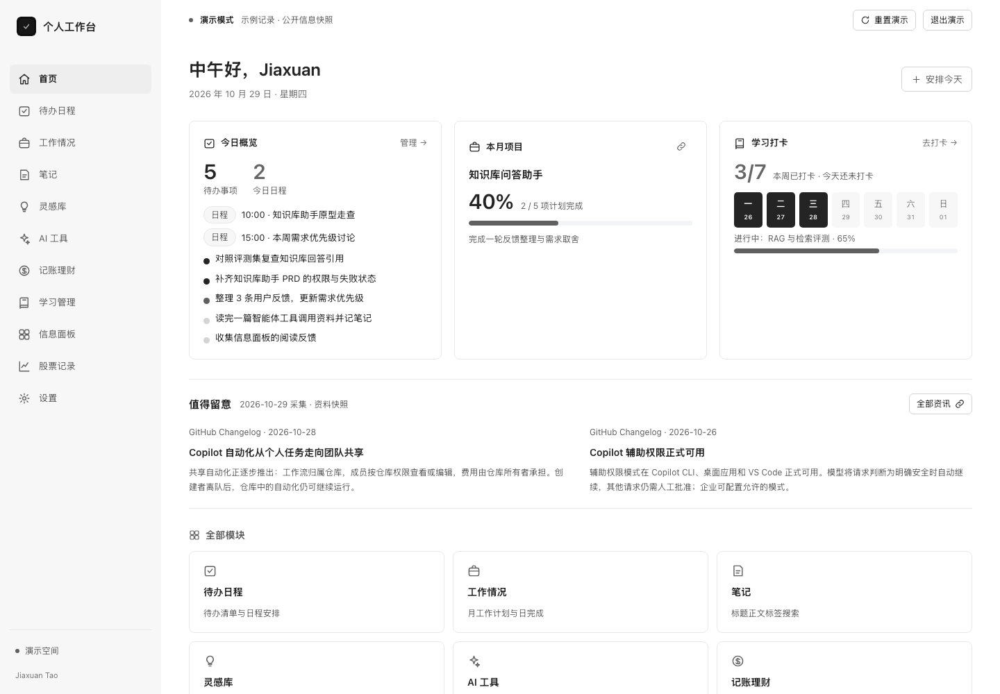
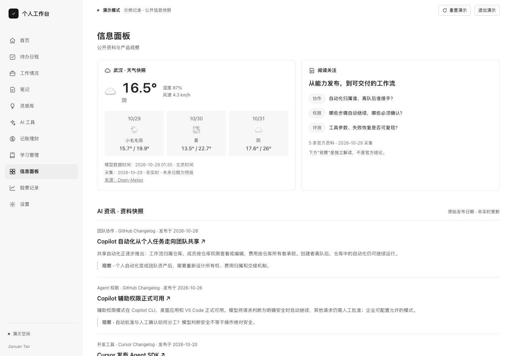

# Personal Workbench｜个人工作台

把今天要做的事、正在推进的工作、随手记下的想法，放进同一个工作空间。

这是一个无需注册的个人效率 Web 工具：可以安排待办与日程、记录月度计划和每日进展、整理笔记与提示词，也可以记账、学习打卡和查看公开信息。界面采用黑白灰配色，提供浅色与深色两种外观，电脑和手机都可以使用。

[打开工作台](https://jiaxuan-tao.github.io/vibe-coding-lab/personal-workbench/) · [体验演示](https://jiaxuan-tao.github.io/vibe-coding-lab/personal-workbench/?demo=1#/dashboard) · [返回实验室](../README.md)



## 先体验，再开始记录

首次打开是空白的个人空间。点击右上角「体验演示」，可以查看一个围绕知识库问答助手展开的完整工作场景：今日任务、日程、月计划、工作日志、产品笔记、灵感、提示词和学习进度都有内容，可以直接修改和保存。

- **演示与个人数据分开保存。** 退出演示回到原来的个人空间；重置只恢复演示数据，不清空个人记录。切换空间前请保存正在编辑的内容。
- **示例记录可重复体验。** 完成待办后首页计数同步变化，更新月计划后项目进度同步变化。演示任务和计划按打开当天调整日期，跨日仍保留已保存的编辑；这不是用户的真实工作经历。
- **公开信息是固定快照。** 武汉天气保留 Open-Meteo 的原始模型数据时间；AI 资讯来自官方公告，分别显示发布日期、来源和独立产品观察。本次采集日期为 **2026-10-29**，不自动更新，不等于当日新闻或实时热榜。
- **财务数据明确为模拟。** 演示空间的收支、交易和参考价用于演示记录与计算，不是个人资产、市场行情或投资建议；不会请求真实行情或混用个人行情缓存。



来源、日期处理和验证方法见 [演示数据说明](docs/demo-data.md)。

## 功能

| 模块 | 可以做什么 |
| --- | --- |
| 首页 | 查看今日待办、日程与学习进度；演示空间另有项目进度和 AI 资讯摘要 |
| 待办日程 | 新增、编辑、完成与删除待办，设置优先级，记录重要日期 |
| 工作情况 | 管理月度计划，记录项目推进、协作沟通、待跟进事项，整理月度总结，导入导出 Excel |
| 笔记与灵感 | 整理标题、正文和标签，搜索笔记，快速记录一句话想法 |
| AI 工具 | 打开常用 AI 网站，收藏和复制自己的提示词 |
| 记账理财 | 记录收支与分类，查看月度结余、分类占比和半年趋势 |
| 学习管理 | 设置计划进度、每日打卡、查看连续记录与月历 |
| 信息面板 | 手动选择城市看天气，查看公开热榜，打开常用网站 |
| 股票记录 | 手动录入买卖、自选与投资笔记；可选查询公开行情 |
| 设置与备份 | 切换黑白主题、设置称呼与城市、导出和恢复本地 JSON 备份 |

手机底部保留首页、待办和笔记，其他模块从“更多”进入。

## 开始使用

1. 打开“待办日程”，添加今天的事情或重要日期。
2. 在“工作情况”记录月度目标和当天进展；笔记点击“保存笔记”保存正文。
3. 在设置里填写称呼、选择天气城市；行情查询默认关闭，需要时主动开启。
4. 定期导出备份。恢复备份会替换当前数据，应用会先校验并要求确认。

JSON 备份最大 5 MiB，支持本版备份以及字段兼容的原版裸 JSON 数据；不接受凭据、未知字段或无效日期。工作计划和日志另支持 Excel 导入导出。

## 数据与边界

- **数据在当前浏览器，不是云端账户。** 不收集或上传日程、笔记、账目，不要求 GitHub Token，不自动创建仓库，也不跨设备同步。
- 清除网站数据、换浏览器、隐私模式结束或设备损坏都可能丢失本地内容。导出的备份包含个人资料，请自行妥善保管；存储空间不足会明确显示保存失败，不把失败说成成功。失败后的笔记和日志草稿只在当前页面内暂存，关闭页面前请保留内容或重试保存。
- 建议只在一个标签页编辑。保存前会检查其他页面是否已更新数据，发现冲突时阻止旧页面覆盖；浏览器存储不是数据库事务，不保证极端同时写入的原子性。遇到冲突先保留草稿，再刷新重试。
- 本地存储命名空间避免与实验室其他应用意外覆盖，但**同源网页并非安全隔离环境**，不建议保存密码、密钥或高度敏感资料。
- 初次联网加载并完成离线缓存后，可离线打开主要本地功能；天气、新闻、行情需要网络。离线缓存是否保留也受浏览器策略影响。
- 待办是按日期安排，**没有网页关闭后的后台推送，也没有分钟级闹钟**。
- AI 工具是网站入口与提示词收藏，不内置模型推理。月度总结是根据记录做规则整理，不是 AI 生成。
- 天气来自 Open-Meteo，城市由用户主动选择，不读取设备位置。热榜依赖公开接口，失败时显示失败状态与网站入口，不用演示新闻冒充实时信息。
- 以上在线信息能力适用于个人空间；演示空间只读取随应用打包的快照，不访问天气、热榜或行情接口。链接到原始资料仍需要网络；首次打开在线站点也需要网络，已完成离线缓存后可断网重访。
- 行情查询默认关闭。开启后仅向公开接口发送证券代码；以数据读取代替远程脚本执行。接口跨域限制、网络和服务变化都可能导致无行情；缓存不等于实时数据。记录与计算不含手续费、税费、分红或多币种换算；缺少买入记录会标注记录不完整。

## 本地运行

需要 Node.js 22+ 和 Python 3。应用没有运行时 npm 依赖；安装的 Playwright 仅用于回归测试。

```sh
npm ci
npm run dev
# http://127.0.0.1:5191/

npm test
npx playwright install chromium
npm run test:browser
npm run build
```

生产静态文件输出到 `dist/`，可部署到 GitHub Pages 等静态托管。

### 本地备用演示

需要 Python 3，无需安装第三方依赖：

```sh
python3 start-demo.py
```

macOS 也可双击 `open-demo.command`。启动后自动打开演示模式；优先使用 `dist/`，未构建时使用源码目录。只监听本机，不上传数据。若没有 Python 3，可使用前面的 Node/Python 开发环境方案，或直接访问在线演示。

本地服务与线上站点属于不同来源，浏览器数据不会自动互通。可在演示空间「设置」中导出和恢复独立的 JSON 备份；演示备份文件名带 `demo`，不会在退出演示时自动导入个人空间。

验收范围和已知限制见 [验证记录](docs/verification.md)。
