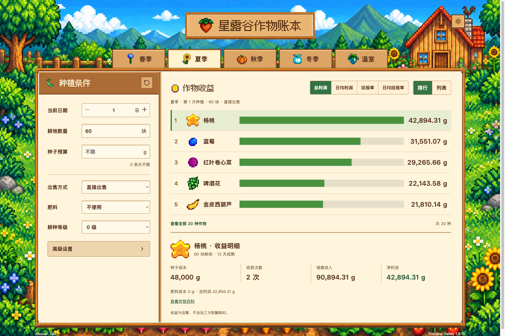

# 🌱 Stardew Crop Ledger｜星露谷作物账本

下一季种蓝莓还是杨桃？加肥料是否划算？同一批作物直接卖、酿酒还是做罐头，差多少收益？

**星露谷作物账本**是一个中文 Web 作物收益计算器。填入种植日期、耕地数量和种子预算，就能比较不同作物的预计利润；也可以加入肥料、职业、食物和加工条件，查看每种方案的成本与收益明细。

[在线体验](https://jiaxuan-tao.github.io/vibe-coding-lab/stardew-crop-ledger/) · [返回轻量项目实验室](../README.md)



## 🧮 能做什么

| 功能 | 内容 |
| --- | --- |
| 季节选择 | 春、夏、秋、冬与温室；包含 49 个原版数据条目 |
| 种植规划 | 播种日期、耕地数量、首批种子预算、跨季种植、温室计算周期 |
| 出售方式 | 直接出售、罐头瓶、酿酒桶、种子生产器、脱水机与磨坊 |
| 条件对比 | 7 种肥料设置、等级、耕种/采集职业、食物加成 |
| 加工选项 | 设备数量、余量出售、不能加工的原料回退、陈酿品质、按次脱水 |
| 成本与留种 | 种子/肥料成本开关、种子来源、补种留种与次年留种 |
| 收益结果 | 总利润、日均利润、回报率、日均回报率；排行与列表视图 |
| 单作物明细 | 种子成本、肥料成本、收获次数、销售收入、净利润与数量明细 |
| 随机预测 | 可重复的品质/额外产量抽样，支持重新预测；大计算在后台线程执行 |
| 本地体验 | 设置自动保存在浏览器，重置、手机收益明细面板，无登录和后端 |

## 🎮 怎么用

1. 选择季节，填写当天日期和可用耕地。温室改为指定计算天数。
2. 选择出售方式、肥料和等级。需要职业、来源或设备限制时打开高级设置。
3. 查看前五名，或展开全部作物。切换指标比较利润与资金回报。
4. 点击作物，查看其成本与收入。手机上会打开收益明细面板。

**每一行是一种独立种植方案**：假设该作物占满设定的耕地。不要把所有行的利润加起来当作混种农场总收益。

种子预算不填或填写 `0` 表示不限；加工设备填写 `0` 同样表示不限。预算只限制首批种子数量，后续补种成本另计。切换职业会遵循等级依赖，不满足等级时自动取消。小屏金额采用「万 / 亿」简写，收益明细保留完整数值。

## 📐 计算边界

- 数据对应 **Stardew Valley 1.6.15**，不是自动跟随游戏更新的数据服务。
- 默认品质和额外产量采用期望值。开启随机预测后是抽样估算，不是读取存档的实际随机结果。
- 及时浇水、及时收获并补种；忽略玩家操作时间。生长加速沿用近似公式，不逐阶段模拟游戏。
- 加工设备按批次限制，**不模拟加工耗时和机器排程**；陈酿直接按目标品质计价，不扣除陈酿天数。
- 特殊来源种子可能无法购买。价格 `0` 表示模型不计购买成本，不等于商店免费出售；顶级肥料/生长激素按自制零成本处理。
- 留种沿用平均每份原料产出两粒种子的近似，可能出现小数。日均收益按计算跨度摊销；日均回报率沿用模型的单次成熟/复收折算口径。
- 不计算蜂蜜、巨型作物、果树、动物、模组，不读取存档或位置。
- 地块与设备上限 10,000，种子预算上限 100,000,000 g，温室周期上限 1,120 天。
- 浏览器禁用存储时仍可使用，但刷新后无法保留设置。

## 🛠️ 本地运行

页面使用原生 JavaScript ES Modules，无运行时框架和远程 API。需要静态 HTTP 服务，不建议用 `file://` 直接打开。

```bash
cd stardew-crop-ledger
npm ci
npm run dev
```

打开 `http://127.0.0.1:5188/`。生产构建不需要编译框架，整理本地模块与素材到 `dist/`：

```bash
npm test
npx playwright install chromium
npm run test:browser
npm run build
```

## 📁 实现结构

- `engine.js` / `vendor/`：计算与数据，独立于 DOM。
- `settings.js`：本地设置与日期转换。
- `app.js` / `index.html` / `styles.css`：中文交互和响应式像素农场界面。
- `calculation-client.js` / `calculation-worker.js`：后台计算与取消旧任务。
- `tests/`：原版对照、独立经济用例、输入/保存与浏览器交互测试。
- `docs/`：视觉素材记录、计算兼容性说明和真实运行截图。

## 📜 来源与许可

计算基础与作物数据来自 Stardew-Profits，界面、本地化、交互和状态管理重新实现。原版代码许可、游戏素材版权与像素字体许可分开记录在 [第三方声明](THIRD_PARTY_NOTICES.md)。

这是非官方玩家工具，不与游戏开发者关联。素材不因原项目的 MIT 代码许可而转为 MIT。
