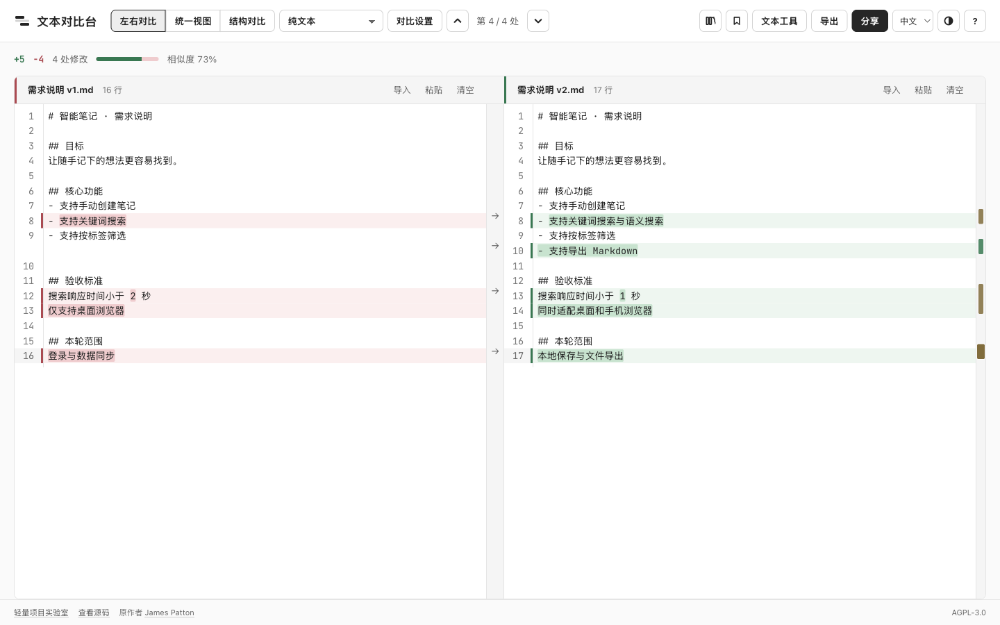
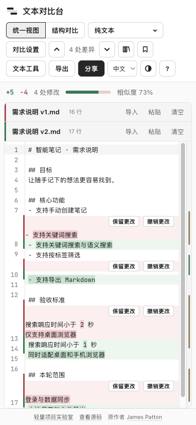

# Text Compare｜文本对比台

把两版需求、文案或提示词放在一起，看清哪里新增、哪里删除、哪里改了。

文本对比台是一个浏览器里的内容对比工具。默认中文，可即时切换英文；黑白灰界面支持浅色、深色和跟随系统。无需注册，也不需要填写 API Key，文字和文件在本地浏览器处理。

[在线体验](https://jiaxuan-tao.github.io/vibe-coding-lab/text-compare/) · [返回实验室](../README.md)



## 可以用来做什么

- **需求版本核对**：比较两版 PRD 或验收标准，定位变动段落。
- **文案与提示词迭代**：查看一轮修改究竟调整了哪些词句，按块保留或恢复。
- **配置与表格检查**：比较 JSON、CSV、TSV 或 Excel 中的内容，减少格式和键顺序的干扰。
- **文件内容复核**：导入 Word、PDF 或图片查看差异，必要时导出一份报告给别人。

## 功能

| 功能 | 说明 |
| --- | --- |
| 双栏 / 统一视图 | 两侧均可编辑，手机默认采用统一视图 |
| 差异定位与合并 | 高亮增删、按词或按字符比较，跳转到上一处 / 下一处差异，按块合并 |
| 对比规则 | 忽略大小写、空行、行尾空白或所有空白，支持自定义正则忽略规则 |
| 结构化数据 | 对比 JSON 对象与 CSV / TSV 表格，支持按结构查看变化 |
| 文档导入 | 支持 `.txt`、代码文件、`.docx`、`.xlsx` 与有可选文字的 `.pdf` |
| 图片对比 | 并排、滑动、叠加和像素差异视图 |
| 本地记录 | 保存、搜索、重命名、重新打开和删除对比，历史记录可关闭 |
| 导出与分享 | HTML 报告、打印为 PDF、`.patch`、两侧原文下载，或生成文本分享链接 |
| 中英文与外观 | 即时切换界面语言，不修改输入内容；记忆语言和外观偏好 |

## 开始使用

1. 在两侧粘贴文字，或分别点击「导入」选择文件；也可一次拖入两个文件。
2. 查看高亮和差异统计，通过箭头跳转到不同修改位置。
3. 在「对比设置」中选择忽略规则，在「文本工具」中格式化 JSON、交换两侧或整理空白。
4. 保存需要保留的对比，或从「导出」下载报告。

移动端使用统一视图，仍可分别导入原文与修改稿。



## 隐私与能力边界

- **内容不上传**：文件解析、对比、报告生成都在当前浏览器执行，无云同步、账号或分析追踪。
- **本地不等于永久保存**：记录仅存在当前浏览器。清除站点数据、换设备或使用隐私窗口后，记录可能不可用。重要内容请另行下载。
- **分享不是加密**：分享链接中包含完整文本与文件名。拿到链接的人都能读取，复制前会再次提醒，不适合机密信息。较长链接可能被聊天软件截断。
- **不是 OCR 或版式审阅器**：扫描版 PDF 不会自动识字；Word、Excel、PDF 主要比较提取后的文字或表格内容，不还原完整排版、公式计算和修订批注。
- **大文件受设备限制**：解析、渲染和历史存储依赖浏览器内存与空间；复杂 PDF 或大量数据可能较慢。
- **编码范围**：支持 UTF-8、带 BOM 的 UTF-16，并有 Windows-1252 回退；不承诺 GBK 等编码自动识别，请先转换为 UTF-8。
- **离线使用**：生产页面首次加载并缓存后，可继续使用已缓存的功能；尚未加载过的 PDF 或代码语言模块可能仍需联网一次。
- 同一 GitHub Pages 域名下的应用共享浏览器来源。本项目隔离了存储键与缓存命名，但这不是独立域名级的安全隔离。

## 本地运行

需要 Node.js 22.12 或更高版本。

```sh
npm ci
npm run dev
# http://127.0.0.1:5192/

npm test
npx playwright install chromium
npm run test:e2e
npm run build
```

构建输出为 `dist/`，可部署到 GitHub Pages 等静态托管，并支持项目子目录路径。

验证范围与已知限制见 [验证记录](docs/verification.md)。

## License

[AGPL-3.0](LICENSE) · Copyright © 2026 James Patton。可见署名及其他适用条件见 [NOTICE](NOTICE)，第三方组件说明见 [THIRD_PARTY_NOTICES.md](THIRD_PARTY_NOTICES.md)。
